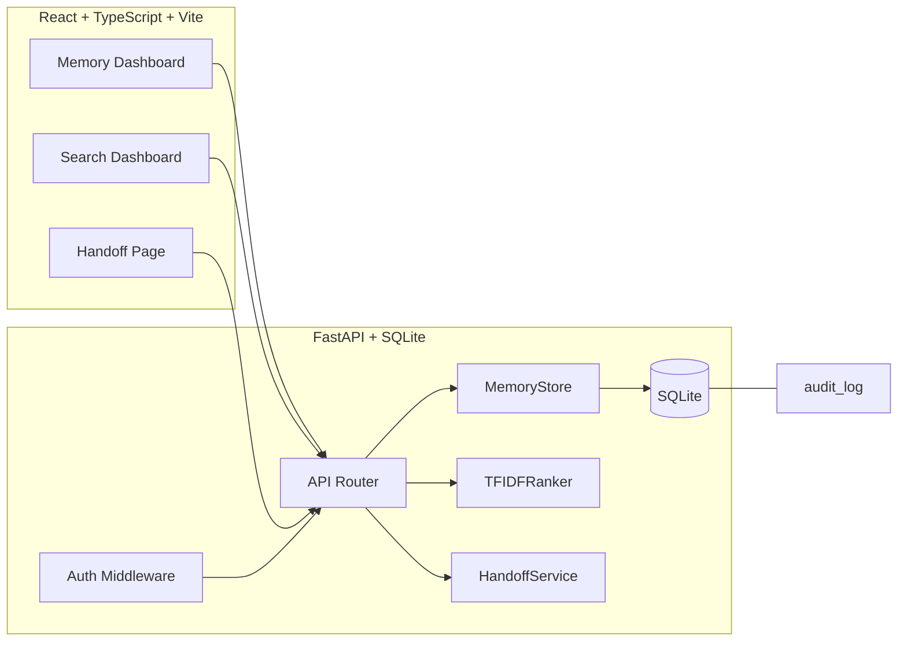

# Nexus Station — Alan Vo | AI & Machine Learning

> Work in progress. This checkpoint may be incomplete or fail tests. See PLAN.md and STATUS.md before use.


**Problem:** Coding agents from different vendors (Claude Code, Codex, OpenCode, etc.) have
no shared memory layer. When a task transitions from one agent to another, session context is
lost. Nexus Station provides a memory store where agents can save session context and retrieve
relevant memories via semantic search when another agent vendor takes over.

**Implemented approach:** A deterministic TF-IDF cosine-similarity ranking engine for memory
retrieval — no LLM key required for the core search. Optional LLM-powered advisory explanations
are a planned future milestone. All ranking is offline and reproducible.

**Intended user:** Developers and agent orchestrators who need durable, searchable memory
across agent sessions and vendor boundaries.

---

## Architecture



## Features

| Feature | Status | Description |
|---------|--------|-------------|
| Memory storage | Done | Create, read, list, update, delete memories with tags and agent vendor metadata |
| Semantic search | Done | TF-IDF cosine similarity ranking engine — deterministic, offline, no LLM required |
| Handoff bundles | Done | Export/import structured JSON bundles with conflict resolution (new/skip/replace) |
| Audit log | Done | All mutations recorded with timestamps |
| Pagination & filtering | Done | List memories with page/per_page, filter by vendor or tag |
| Local demo auth | Done | Shared-secret API key, binds to 127.0.0.1 only |
| OIDC / Keycloak SSO | Planned | Architecture stubbed; requires `AUTH_MODE=production` + `OIDC_DISCOVERY_URL` |
| LLM advisory | Planned | Opt-in explanations via OpenAI/Anthropic/Gemini adapters |

## Quick Start

```bash
# Backend
cd backend
python3 -m venv ../.venv
../.venv/bin/pip install -r requirements.txt
PYTHONPATH=backend ../.venv/bin/python -m pytest tests/  # verify
PYTHONPATH=backend ../.venv/bin/python -m uvicorn app.main:app --reload --host 127.0.0.1 --port 8000

# Frontend
cd frontend
npm install
npm run dev  # http://localhost:5173

# Or with Docker
docker compose up --build
# API: http://127.0.0.1:8000  |  UI: http://127.0.0.1:5173  |  Keycloak: http://127.0.0.1:8080
```

### API Quick Reference

All endpoints are under `/api/v1/` and require `Authorization: Bearer <LOCAL_API_KEY>`.

| Method | Endpoint | Description |
|--------|----------|-------------|
| GET | `/healthz` | Health check |
| POST | `/memories` | Create a memory |
| GET | `/memories` | List memories (query: page, per_page, agent_vendor, tag) |
| GET | `/memories/{id}` | Get a single memory |
| PATCH | `/memories/{id}` | Update a memory |
| DELETE | `/memories/{id}` | Delete a memory |
| GET | `/search?q=...` | Semantic TF-IDF search (query: q, limit, agent_vendor, tag) |
| GET | `/search/stats` | Ranking engine corpus statistics |
| POST | `/handoff/export` | Export memories as a handoff bundle |
| POST | `/handoff/import` | Import memories from a bundle |

### Example

```bash
# Create a memory
curl -X POST http://localhost:8000/api/v1/memories \
  -H "Authorization: Bearer dev-only-key" \
  -H "Content-Type: application/json" \
  -d '{"title":"Fix auth bug","content":"OAuth callback state validation","tags":["auth"],"agent_vendor":"claude-code"}'

# Search semantically
curl "http://localhost:8000/api/v1/search?q=oauth+callback" \
  -H "Authorization: Bearer dev-only-key"
```

## Installation

### Prerequisites

- Python 3.12+
- Node.js 24+
- Docker + Docker Compose (optional, for containerized deployment)

### Backend

```bash
cd backend
python3 -m venv .venv
.venv/bin/pip install -r requirements.txt
PYTHONPATH=backend .venv/bin/python -m pytest tests/
```

### Frontend

```bash
cd frontend
npm ci
npm run build
npx vitest run
```

## Configuration

Copy `.env.example` to `.env` and adjust values:

| Variable | Default | Description |
|----------|---------|-------------|
| `DATABASE_URL` | `sqlite:///./nexus_station.db` | SQLite database path |
| `AUTH_MODE` | `local` | `local` (demo) or `production` (OIDC) |
| `LOCAL_API_KEY` | `dev-only-key` | API key for local demo mode |
| `OIDC_DISCOVERY_URL` | — | OIDC discovery endpoint (production) |
| `OIDC_CLIENT_ID` | — | OIDC client ID (production) |
| `OIDC_AUDIENCE` | — | OIDC audience claim (production) |
| `LLM_API_KEY` | — | LLM API key (optional, future milestone) |
| `LLM_PROVIDER` | `openai-compatible` | LLM provider selection |
| `LLM_MODEL` | `gpt-3.5-turbo` | LLM model name |
| `LLM_BASE_URL` | — | Custom API base URL |

## Security Limitations

- **Local demo mode** binds to `127.0.0.1` only. Production mode (`AUTH_MODE=production`)
  refuses to start without OIDC discovery configured (`OIDC_DISCOVERY_URL`).
- **No hardcoded credentials** are committed. The default `LOCAL_API_KEY` is for local
  development only and must be changed in production.
- **OIDC / Keycloak** integration is a planned milestone. The auth stub raises HTTP 501
  when OIDC is requested but not configured.
- LLM API keys are never sent to the client. LLM requests are server-side only.
- See [docs/security.md](docs/security.md) for more details.

## AI/ML Evaluation

### TF-IDF Ranking Engine

The core search engine uses TF-IDF vectorized representations of memory titles and content,
ranked by cosine similarity. This is deterministic — the same query and corpus always produce
the same ranking, with no LLM dependency.

**Reproducible command:**

```bash
PYTHONPATH=backend .venv/bin/python -m pytest backend/tests/test_ranking.py -v
```

**Data provenance:** Test data is synthetic memory records created in-test (see `_sample_memories()`
in `test_ranking.py`). No external datasets are used.

**Baseline:** The ranking engine is the baseline — there is no training or model fitting.
TF-IDF parameters follow standard conventions (term frequency = count/total, IDF with +1
smoothing as per sklearn).

**Measured results:** 13 ranking tests pass, verifying:
- Empty corpus and empty query return no results
- Relevant documents rank higher than irrelevant ones
- Results are deterministic (same query → same ranking)
- Scores are in [0, 1]
- Rare terms receive higher IDF weighting

**Failure cases:**
- Queries with no matching terms return empty results (by design)
- Very short documents with no overlap with the query get zero similarity
- TF-IDF is a bag-of-words model; it does not understand synonyms or semantic meaning
  beyond term overlap

## Provider Configuration

| Provider | Adapter | Configuration |
|----------|---------|---------------|
| OpenAI-compatible | httpx (future) | `LLM_API_KEY`, `LLM_PROVIDER=openai-compatible`, `LLM_BASE_URL` |
| Anthropic Claude | httpx (future) | `LLM_API_KEY`, `LLM_PROVIDER=anthropic` |
| Google Gemini | httpx (future) | `LLM_API_KEY`, `LLM_PROVIDER=gemini` |
| Ollama | httpx (future) | `LLM_API_KEY=` (optional), `LLM_PROVIDER=ollama`, `LLM_BASE_URL=http://localhost:11434` |

> **Note:** LLM adapters are a planned future milestone. The core system works fully offline
> without any LLM configuration.

## SSO / SAML Setup

Nexus Station supports OIDC authentication through Keycloak, with SAML identity brokering
for upstream providers (Okta, Azure AD, Google Workspace, etc.).

**To enable production auth:**

1. Start Keycloak (included in `compose.yaml`):
   ```bash
   docker compose up -d keycloak
   ```

2. Configure the realm, client, and SAML identity provider in the Keycloak admin console
   at `http://localhost:8080`.

3. Set environment variables:
   ```bash
   AUTH_MODE=production
   OIDC_DISCOVERY_URL=http://localhost:8080/realms/nexus-station/.well-known/openid-configuration
   OIDC_CLIENT_ID=nexus-station-client
   OIDC_AUDIENCE=nexus-station-api
   ```

**SAML setup (through Keycloak identity brokering):**
1. In Keycloak, go to your realm → Identity Providers → SAML
2. Upload the IdP metadata XML from your SAML provider
3. Map SAML attributes to Keycloak user attributes
4. Configure the SAML client as the identity provider for the Nexus Station realm

**Demo mode (local-only):**
```bash
AUTH_MODE=local
LOCAL_API_KEY=dev-only-key
```
Demo mode binds to `127.0.0.1` and must never be used in production.

## Docker Deployment

```bash
docker compose up --build
# API: http://127.0.0.1:8000  |  UI: http://127.0.0.1:5173  |  Keycloak: http://127.0.0.1:8080
```

### TLS Reverse Proxy

For production, terminate TLS at a reverse proxy (nginx, Caddy, Traefik) and forward
to the backend and frontend containers:

```nginx
server {
    listen 443 ssl http2;
    server_name nexus.example.com;

    ssl_certificate /path/to/cert.pem;
    ssl_certificate_key /path/to/key.pem;

    location /api/ {
        proxy_pass http://127.0.0.1:8000;
        proxy_set_header Host $host;
        proxy_set_header X-Real-IP $remote_addr;
    }

    location / {
        proxy_pass http://127.0.0.1:5173;
    }
}
```

### Backup and Restore

```bash
# Backup
sqlite3 nexus_station.db ".backup backup.db"

# Restore
cp backup.db nexus_station.db
```

## Development

```bash
# Backend with hot reload
PYTHONPATH=backend .venv/bin/python -m uvicorn app.main:app --reload --host 127.0.0.1 --port 8000

# Frontend with hot reload
cd frontend && npm run dev

# Run all tests
PYTHONPATH=backend .venv/bin/python -m pytest backend/tests/
cd frontend && npx vitest run
```

## Project Structure

```
nexus-station-alan-vo/
├── backend/
│   ├── app/
│   │   ├── main.py          # FastAPI app factory
│   │   ├── core/            # Config, database, auth
│   │   ├── models/          # Pydantic models
│   │   ├── services/        # Domain engine: store, ranking, handoff
│   │   └── api/             # API routes
│   ├── tests/               # pytest test suite
│   ├── requirements.txt
│   ├── Dockerfile
│   └── pyproject.toml       # Backend package metadata
├── frontend/
│   ├── src/
│   │   ├── main.tsx         # React entry
│   │   ├── App.tsx          # App with routing
│   │   ├── api/             # Typed API client
│   │   ├── components/      # UI components
│   │   ├── hooks/           # Data hooks
│   │   └── __tests__/       # Vitest tests
│   ├── index.html
│   ├── package.json
│   ├── package-lock.json
│   ├── vite.config.ts
│   ├── tsconfig.json
│   └── Dockerfile
├── .github/workflows/ci.yml
├── compose.yaml
├── portfolio.json
├── README.md
├── LICENSE
└── Changelog.md
```

---

Alan Vo <alanvo@gmail.com> | [GitHub](https://github.com/ALANDVO/nexus-station-alan-vo)